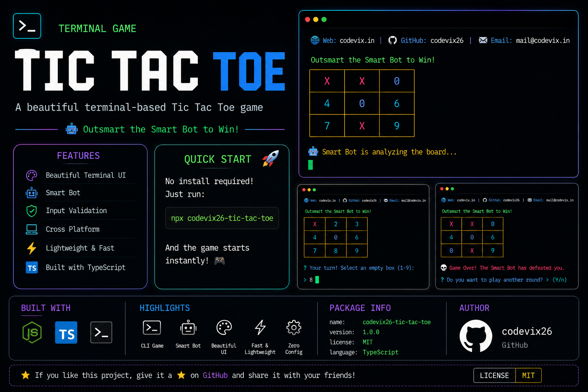
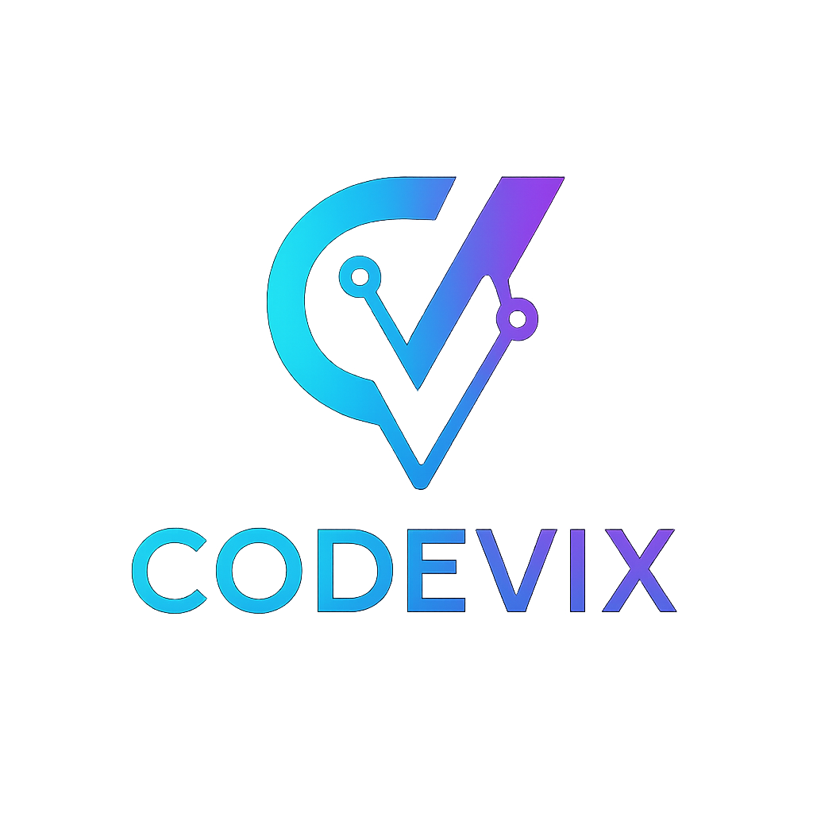
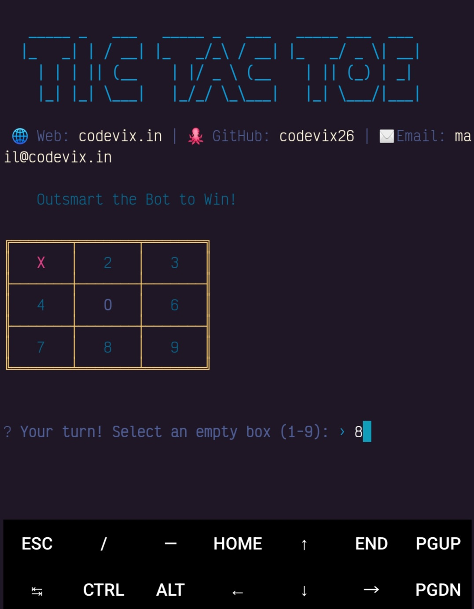
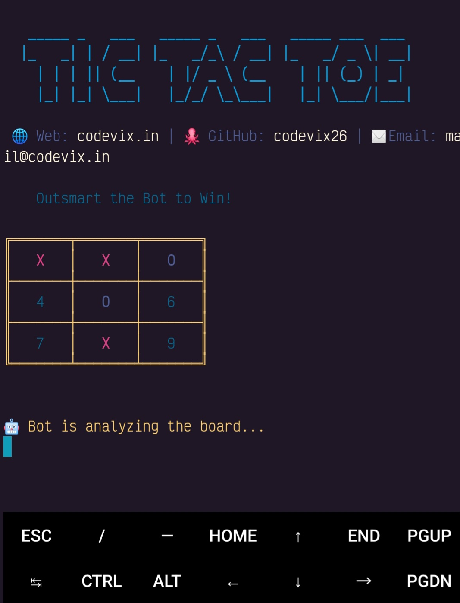
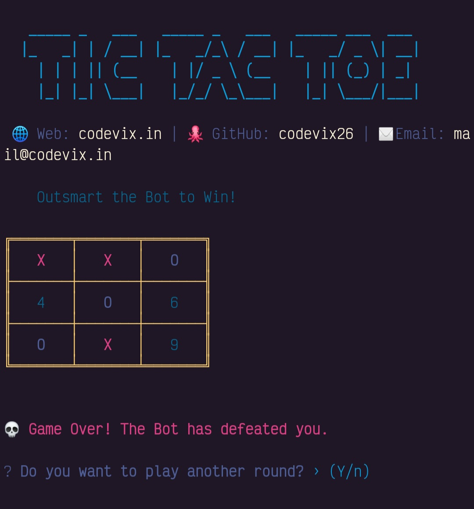
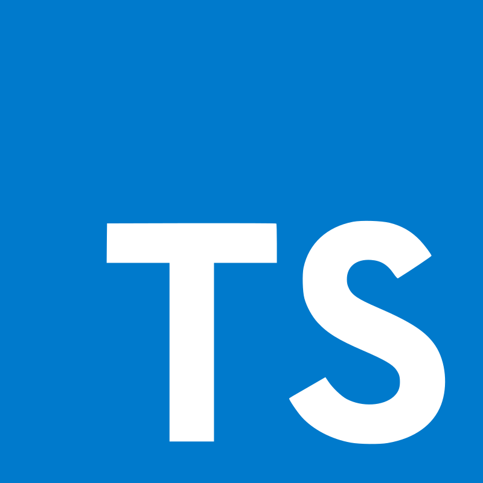
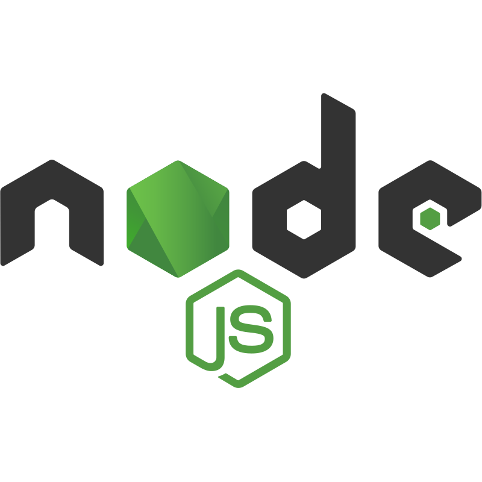

<div align="center">
  
  <br />
  <br />
  
  
  # Codevix Tic-Tac-Toe

  **A premium, interactive terminal-based Tic-Tac-Toe game built with Node.js & TypeScript.**

  [](https://www.npmjs.com/package/codevix-tic-tac-toe)
  [](https://opensource.org/licenses/MIT)

  [Play Instantly](#-play-instantly) • [Features](#-features) • [Gameplay](#-gameplay) • [Development](#-local-development)
</div>

---

## 🚀 Play Instantly (No Installation Required)

You do not need to clone the repository to enjoy the game! If you have Node.js installed, simply open your terminal and run the following command to start playing immediately:

```bash
npx codevix-tic-tac-toe
```

---

## ✨ Features

* **Smart AI Opponent:** A heuristic-based AI that prioritizes winning and aggressively blocks your moves. Outsmart the bot to win!
* **Beautiful Terminal UI:** Crafted using double-lined ASCII borders, `cli-table3`, and vibrant `chalk` colors for a premium CLI experience.
* **Seamless Frame Rendering:** Clears the terminal gracefully between turns to provide a static-canvas gaming feel, preventing messy scrolling clutter.
* **Robust Input Validation:** Prevents application crashes from accidental keystrokes and handles forced interruptions (Ctrl+C) smoothly.
* **Production-Ready:** 100% TypeScript, fully object-oriented, strictly typed, and bundled via ESNext ESM standards.

---

## 📸 Gameplay

Experience a beautifully crafted, colorful ASCII interface directly in your command line.

### Player's Turn


### Bot Analyzing


### Game Over Screen


---

## 🏗️ Tech Stack

This project is built using modern, industry-standard tooling:

*  **TypeScript** (Language)
*  **Node.js** (Runtime)
*  **pnpm** (Package Manager)
* **tsup** (ESM Bundler)
* **CLI Libraries:** `chalk`, `cli-table3`, `prompts`, `clear`

---

## 💻 Local Development

If you want to view the source code, tweak the AI, or contribute to the project, follow these steps:

### 1. Clone the Repository
```bash
git clone https://github.com/codevix26/codevix-tic-tac-toe.git
cd codevix-tic-tac-toe
```

### 2. Install Dependencies
This project uses `pnpm` as its primary package manager.
```bash
pnpm install
```

### 3. Run the Game Locally
Execute the development script to run the TypeScript files directly.
```bash
pnpm dev
```

### 4. Build for Production
Compile the TypeScript source code into minified JavaScript (`dist/` folder).
```bash
pnpm build
```

---

## 🤝 Contributing

Contributions, issues, and feature requests are highly welcome! 
Please feel free to check out our [CONTRIBUTING.md](./CONTRIBUTING.md) for details on how to get started.

---

## 👤 Author & Links

Developed with ❤️ by **Codevix**.

*  **Website:** [codevix.in](https://codevix.in)
*  **GitHub:** [@codevix26](https://github.com/codevix26)
* ✉️ **Email:** [mail@codevix.in](mailto:mail@codevix.in)

## ⚖️ License

This project is open-source and distributed under the [MIT License](LICENSE).
